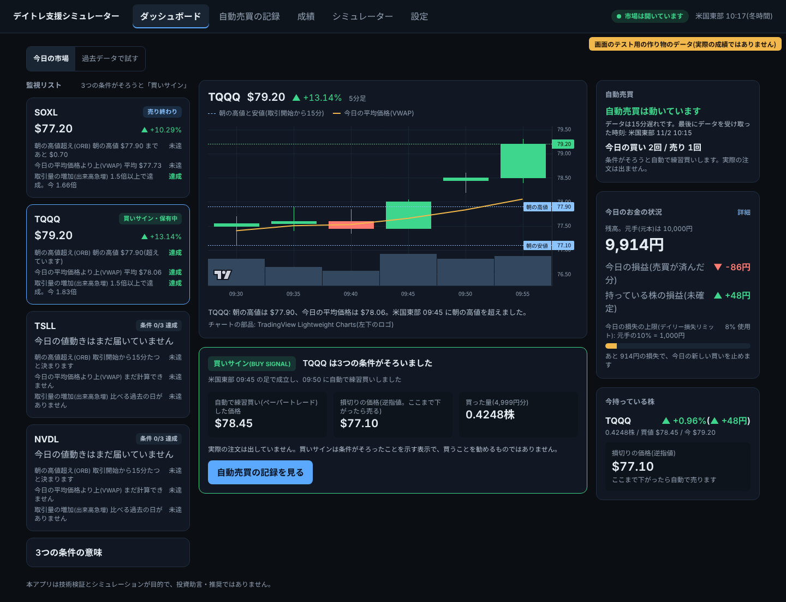
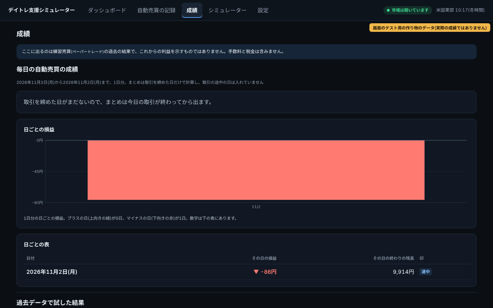
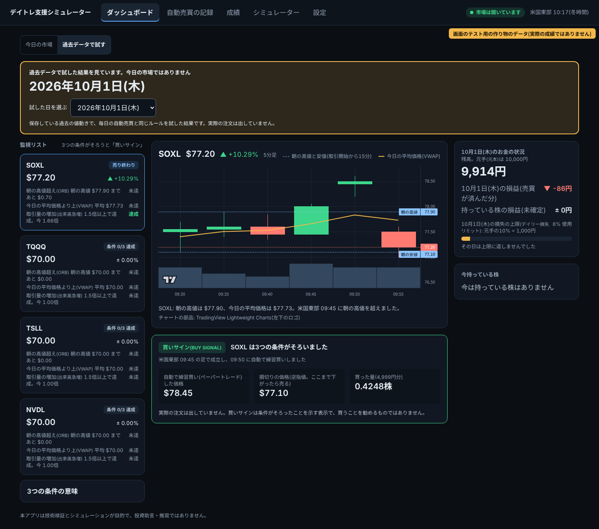
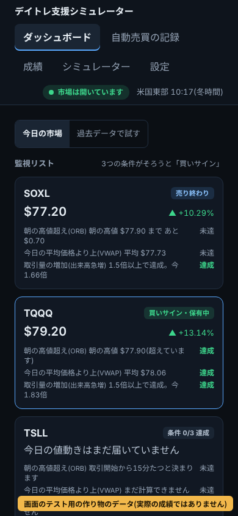

# daytrade-sim

米国株デイトレードのルールを検証するためのアプリです。実際の市場データ(15分遅れ)をためて、決めたルールどおりに練習売買(ペーパートレード)を自動で記録し、成績をためます。実際の発注はしません。

個人のポートフォリオとして作りました。仕様、設計の判断、spec の変更、マージは人間(作者)が決め、実装、テスト、AI によるレビューと指摘の修正は AI(Claude)が行う進め方で作っています(下の「作り方」)。

## 免責事項

- 本アプリは技術検証とシミュレーションが目的で、投資助言・推奨ではありません
- 実際の発注は行いません。証券会社とも接続しません。実際の売買に使わないでください
- 練習売買の成績、過去データで試した結果、シミュレーションの結果は、将来の利益を示すものではありません
- 練習売買の成績と過去データで試した結果は、手数料と税金を含みません
- ライセンス(MIT)のとおり、無保証です

## 画面

画面のテスト用の作り物のデータ(2026-11-02 の取引の途中と、過去データで試した41日分)で撮ったものです。画像の左上にもその旨を入れています。実際の成績ではありません。

| ダッシュボード | 成績 |
|---|---|
|  |  |
| 過去データで試した日 | スマホの幅(390px) |
|  |  |

## できること

- **監視と買いサイン**: 4銘柄(SOXL、TQQQ、TSLL、NVDL)の5分ごとの値動きから、3つの条件(朝の高値超え、今日の平均価格より上、取引量の増加)を判定する(SPEC-002)
- **自動の練習売買**: 条件がそろうと次の5分足の始値で練習買いし、損切りの価格、利益を守る売りの目安、取引終了で売る。今日の損失の上限に達したら、その日は新しく買わない(SPEC-003)。別のプロセス(ワーカー)が1分ごとに動く
- **ダッシュボード**: 価格チャート(TradingView Lightweight Charts)、条件の達成状況、今日のお金の状況、ワーカーが止まっていないか(SPEC-007)
- **成績**: 日ごとの損益と残高、まとめ、棒グラフ(SPEC-004)
- **過去データで試す**: 取り込んだ過去の値動きで、同じルールを試す。結果は毎日の記録と分けて出す(ADR-0010)
- **資産シミュレーター**: 1日あたりの想定の利益率が一定で続いたと仮定して、貯金へ回す割合と税金を入れ、複利の資産の推移を計算する(SPEC-005)

## 作り

```
ブラウザ(Next.js の画面) ──► Route Handler(127.0.0.1 だけで待ち受け。このパソコンの画面からだけ呼べる)
                                  │
ワーカー(npm run worker) ──┐     ▼
   1分ごと                 ├──► application(ユースケース) ──► domain(条件の判定、売買、損益、市場の時間。純粋関数)
                           │          │
                           └──────────┴──► infrastructure(SQLite、Alpaca のデータ API、時計)
```

- **domain** は外に依存しない純粋関数です。条件の判定、損切り、損失の上限、複利、税金、休場日と夏時間を、手計算した値と比べるテストで確かめています
- **記録の作り方**: ワーカーは毎回、その日の保存した足を最初から処理し直して記録を置き換えます(ADR-0009)。同じ足を何度処理しても記録は1回分になり、止まっていた間の取り直しも同じ処理で済みます。過去データで試す処理も同じ関数を使います
- **外との通信**: Alpaca のデータ API だけです(ADR-0005、ADR-0006)。接続用キーは画面から入力して DB に保存し、画面やログにそのまま出しません
- 技術: Next.js 16、React 19、TypeScript、Tailwind CSS 4、shadcn/ui、Recharts、Lightweight Charts、SQLite(better-sqlite3、Drizzle ORM)、zod、Vitest、Playwright

## 品質の確かめ方

- CI(GitHub Actions): 型チェック、lint、単体テスト(Vitest)、画面のテスト(Playwright。デスクトップとスマホの幅)、秘密の混入検査(gitleaks で全履歴)
- 受け入れ基準ごとにテストを書き、テスト名に受け入れ基準の ID を入れています(例: `AC-003-01`)
- 画面のテストは、本番の DB とは別の DB と、通信しないテスト用の取得元、止まった時計で動きます
- 色の組み合わせは WCAG AA の比を単体テストで計算しています。仕上げ(T12)で axe-core を作業環境で一度だけ動かし(CI には入れていない)、テスト用のデータの全画面を見ました。見つかった1つの規則の2か所(読み上げから外したグラフの中のフォーカス)を直しました

## 作り方(AI 駆動開発)

[CLAUDE.md](CLAUDE.md) の決まりで進めています。

1. 機能は spec(ID 付きの受け入れ基準)から始め、plan、tasks、実装の順に進める
2. 設計の判断は、実装より先に ADR に選択肢、評価、推奨を書き、人間が決める
3. 実装はブランチで行い、AI の reviewer がレビューする。秘密、外部との通信、保存するデータに触れる変更では security-reviewer もレビューする。指摘は番号、重要度、推奨を付ける。spec や設計の判断が要る指摘は人間が決め、そのほかの指摘は、人間の指示(2026-11-19)により AI が推奨どおりに直す
4. プルリクエストには「AI レビューの指摘」と「人間の判断」を分けて書き、人間が見てマージする
5. タスクごとに、AI が間違えた点を含めて記録を残す

- 設計の判断: [docs/adr/](docs/adr/)(10件)
- 機能の仕様: [docs/spec/](docs/spec/)(7件)
- 計画: [docs/plan/phase1-plan.md](docs/plan/phase1-plan.md)
- AI 駆動開発の記録: [docs/ai-log/](docs/ai-log/)

## わかっている制約

- 自分の Mac で動かす前提です。取引時間(日本時間の夜から朝)にワーカーが動いていないと、その日は記録しません
- データは15分遅れの5分足です。実際の約定の値段、手数料、税金は再現していません
- 休場日の表は 2025 年から 2027 年までです。それより先は表の更新が要ります
- 過去データで試す処理は画面のサーバーの中で同期で動き、その間はほかの画面の読み込みが待たされます。売買のない作り物の足で測って、1年分で約4秒から6秒でした。本物の足と利用者の Mac では測っていません(ADR-0010)
- 接続用キーは暗号化せずに DB に保存します(ADR-0006)

## 開発の始め方

Node.js 22 以上が要ります(`.nvmrc` に書いてあります)。

```bash
npm ci               # package-lock.json どおりに入れる(npm install だと package-lock.json が書き換わり、git pull の邪魔になる)
npm run dev          # http://localhost:3000
npm test             # 単体テスト
npx playwright install chromium   # 初回だけ
npm run test:e2e     # 画面のテスト(テスト用の DB を2つ作り、3100 と 3101 の番号でサーバーを2つ立てる。本番の data/ には触らない)
```

## Alpaca の接続用キーの用意

市場データは Alpaca から取ります(ADR-0005)。練習専用の口座(Paper Only Account)の接続用キーが要ります。

1. https://alpaca.markets でメールアドレスを使って登録する。銀行口座の登録は要らない
2. ダッシュボードの上の切り替えが Paper Trading になっていることを確かめ、右側の API Keys で「Generate New Key」を押す
3. キー ID とシークレットを、パスワード管理アプリなど安全な場所に控える。シークレットは一度しか表示されない
4. `npm run dev` で起動し、http://127.0.0.1:3000/settings の「実際の市場データ」に貼り付けて保存する
5. 「接続を確かめる」を押し、「接続できました」と出ることを確かめる

キーはコミットしない。チャットやメールにも貼らない。

- アプリの設定画面でキーを消した時は、控えたキーを貼り付け直せば元に戻る
- シークレットをなくした時は、Alpaca のダッシュボードでキーを作り直して、保存し直す。作り直すと前のキーは使えなくなる

## 過去データで試す

1. 設定の画面の「過去データの取得」で、期間を選んで4銘柄の過去の値動きを取る(最大1年。取得には Alpaca の接続用キーが要る)
2. 同じ画面の「過去データで試す」を押す。4銘柄すべての値動きがある日を、毎日の自動売買と同じルールで古い順に試す(通信はしない)
3. 成績の画面の「過去データで試した結果」に、まとめと日ごとの表が出る。表の日付を押すと、ダッシュボードでその日のチャートと売買を見られる

- 元手と為替は、設定の画面で最後に保存した値を使い、損益は次の日に引き継ぐ(ADR-0010)
- 結果は毎日の記録とは別に保存し、試すたびに置き換える
- 過去データで試した結果は、将来の利益を示すものではない

## 自動の練習売買を動かす

自動の練習売買は、画面のサーバーとは別のプロセス(ワーカー)で動きます(ADR-0007)。画面のサーバーと同じフォルダで、もう1つのターミナルから起動します。

```bash
caffeinate -i npm run worker   # Mac がスリープしないようにして動かす。止める時は Ctrl+C
```

- 米国市場の取引時間(日本時間の夜から朝)に、1分ごとに4銘柄の5分ごとの値動きを Alpaca から取り、練習売買を記録します。実際の注文は出しません
- データは15分遅れなので、記録も15分から20分遅れて増えます
- 途中で止めても、その日のうちに動かし直せば、止まっていた間の値動きを取り直して同じ記録を作ります(「あとから処理」の印が付きます)。丸1日動かさなかった日は記録しません
- 手数料と税金は含みません。練習売買の成績は、将来の利益を示すものではありません
- ワーカーは `.env.local` を読みません。DB の場所(`DAYTRADE_DB_PATH`)を変えたい時は、画面のサーバーとワーカーの両方に同じ値を渡してください。通常は変える必要はありません
- 動いている間は、ダッシュボード(http://127.0.0.1:3000/)と自動売買の記録の画面が1分ごとに読み直して、記録を出します。ワーカーが3分を超えて動いていないと「自動売買が止まっています」と出ます
- 新しいコードを取り込んだ時は、ワーカーを Ctrl+C で止め、`git pull` と `npm ci` のあとに起動し直してください
- ワーカーを2つ同時に動かさないでください(記録は二重になりませんが、Alpaca への通信が2倍になります)

## 保存するデータ

- 設定、市場データの接続用キー、ためたデータは、このフォルダの `data/daytrade.db`(SQLite)に保存します。`data/` はコミットしません
- 接続用キーは暗号化せずに保存します(ADR-0006)。DB ファイルを他人に渡すと、キーも渡ります
- `data/` を消すと、設定とためたデータが消えます

## ライセンス

[MIT](LICENSE)。無保証です。実際の売買に使わないでください。
